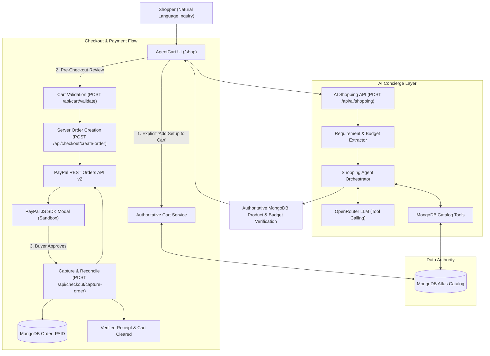

# AgentCart AI — Intelligent Personal Shopping Assistant

[](https://nextjs.org/)
[](https://react.dev/)
[](https://www.typescriptlang.org/)
[](https://tailwindcss.com/)
[](https://www.mongodb.com/)
[](https://developer.paypal.com/)
[](https://opensource.org/licenses/MIT)

> **"Shopping should feel effortless."**  
> AgentCart is an AI-powered personal shopping concierge built for the **PayPal AI Hackathon**. Instead of manually navigating hundreds of fragmented product pages, shoppers describe their goals and budget in natural language. AgentCart analyzes requirements, executes live catalog tools against an authoritative MongoDB database, compares options, provides transparent budget breakdowns, and allows seamless checkout through PayPal Sandbox.

---

## 🌟 The Core Innovation

Most "AI shopping" demos simply bolt a generic chatbot onto a static web page that hallucinates prices, recommends out-of-stock items, or performs client-side arithmetic.

**AgentCart introduces a production-grade, backend-authoritative architecture:**

1. **AI Is Not the Source of Truth:**  
   The LLM never invents prices, specifications, or stock counts. All recommendations are powered by real-time MongoDB tool calls (`search_products`, `get_product_details`, `compare_products`, `check_inventory`, `calculate_budget`).
2. **Deterministic Minor-Unit Financial Arithmetic:**  
   All monetary amounts are stored and calculated strictly in integer minor units (cents) to eliminate IEEE 754 floating-point inaccuracies ($149.99 = `14999`).
3. **Explicit Human Approval Boundary:**  
   The AI agent suggests, analyzes, and explains—it never mutates the customer's cart without explicit user approval.
4. **Dual-Engine Resilience:**  
   If the LLM provider experiences latency or outages, AgentCart automatically switches to a deterministic MongoDB fallback pipeline, ensuring the demo never crashes or leaves the user hanging. The UI transparently indicates the source.
5. **Air-Tight PayPal Orders v2 Security:**  
   Server-side order creation and capture, stable session-scoped idempotency keys (`PayPal-Request-Id`), network timeout capture reconciliation, and cryptographically verified webhook signatures.

---

## 🏗️ System Architecture



---

## ⏱️ 3-Minute Hackathon Demo Script for Judges

Follow this rapid script to evaluate AgentCart's core journey from natural language to verified PayPal payment:

### Minute 1: The AI Shopping Concierge
1. **Open AgentCart:** Navigate to the home page (`/`) and click **"Open Shopping Workspace"** (or `/shop`).
2. **Observe Default State:** The initial home office bundle is already loaded, showing a 4-item workspace setup under $1,000 with live budget calculation ($979.96 total, saving $20.04).
3. **Ask a Custom Inquiry:** In the chat input, type:
   > *"I need a creator setup with a 4K monitor and mechanical keyboard under $800."*
4. **Observe Tool Execution:** Notice the badge indicating `OpenRouter AI · Live Catalog Tools`. The agent extracts your $800 budget limit, queries MongoDB, checks real-time stock, and presents matching verified items.

### Minute 2: Comparison & Approval Boundary
1. **Side-by-Side Comparison:** Click the **"Compare Matrix"** button on the recommendation card to open the comparative specs modal. Inspect the display resolution, switch types, and pros/cons.
2. **Budget Verification:** Notice the budget bar reflecting the live calculation in minor units.
3. **Approve Cart Addition:** Click **"Add Setup to Cart"**. Notice the items are validated against live MongoDB stock and atomically added to your cart drawer.

### Minute 3: PayPal Sandbox Checkout & Verified Receipt
1. **Review Cart:** Click **"Review Cart"** and then **"Proceed to Review"**.
2. **Verify Server Pre-Checkout Review:** The modal itemizes each line item, checks stock, and displays the exact total.
3. **Click the PayPal Button:** The official PayPal Sandbox modal opens.
4. **Approve Payment:** Log in with your PayPal Sandbox Buyer account (or the provided test credentials below) and click **"Complete Purchase"**.
5. **View Verified Receipt:** The server verifies the captured funds directly with PayPal, reconciles the order to `PAID`, records internal order ID `AC-2026-XXXXXX`, clears the guest cart, and displays the order confirmation receipt!

---

## 💳 PayPal Sandbox Test Credentials

To test checkout in sandbox mode, use either a Sandbox Buyer account or the Sandbox Debit/Credit Card below:

### Option A: Sandbox Debit or Credit Card (Guest Checkout)

| Field | Value |
|---|---|
| **Card Type** | `MASTERCARD` |
| **Card Number** | `5385791723246805` |
| **Expiry** | `02/2031` |
| **CVC Code** | `Any 3 digits` (e.g. `123`) |

**Test Billing / Shipping Address:**
```text
John Doe
1234 Maple Street
Springfield, IL 62704
Phone: (217) 555-0198
```

### Option B: Sandbox Accounts

| Role | Email | Password |
|---|---|---|
| **Sandbox Buyer** | `sb-u31bu53762535@personal.example.com` | *(Use any standard PayPal Sandbox buyer account from your Developer Dashboard)* |
| **Sandbox Merchant** | `sb-u31bu53762535@business.example.com` | *(Configured application owner)* |

*Tip: You can generate additional test cards or personal sandbox buyer accounts in your [PayPal Developer Dashboard](https://developer.paypal.com/dashboard/accounts).*

---

## 🛠️ Tech Stack

* **Framework:** Next.js 16.4.5 (App Router, Turbopack, React Server Components)
* **Frontend:** React 19.3.0, Tailwind CSS v4, Lucide Icons, Sonner Toasts
* **Database & ODM:** MongoDB Atlas, Mongoose 9.12.0
* **AI & LLM:** OpenRouter API (Tool Calling with Deterministic MongoDB Fallback)
* **Payment Integration:** PayPal REST Orders API v2, `@paypal/react-paypal-js`
* **Validation & Security:** Zod 4.6.7, Minor-Unit Integer Precision, Cryptographic Webhook Verification

---

## 🚀 Quickstart & Local Setup

### 1. Clone & Install Dependencies
```bash
git clone https://github.com/your-username/agentcart-ai.git
cd agentcart-ai
pnpm install
```

### 2. Configure Environment Variables
Copy `.env.example` to `.env.local`:
```bash
cp .env.example .env.local
```

Fill in your configuration:
```env
# Application
NEXT_PUBLIC_APP_URL=http://localhost:3000

# MongoDB Atlas
MONGODB_URI=mongodb+srv://<user>:<password>@cluster.mongodb.net/agentcart?retryWrites=true&w=majority

# AI (OpenRouter)
OPENROUTER_API_KEY=sk-or-v1-your-key
OPENROUTER_MODEL=openrouter/free

# PayPal Sandbox REST Orders v2
PAYPAL_ENVIRONMENT=sandbox
PAYPAL_BASE_URL=https://api-m.sandbox.paypal.com
PAYPAL_CLIENT_ID=your-sandbox-client-id
PAYPAL_CLIENT_SECRET=your-sandbox-client-secret
PAYPAL_WEBHOOK_ID=your-sandbox-webhook-id

# Public PayPal Client ID (must match PAYPAL_CLIENT_ID)
NEXT_PUBLIC_PAYPAL_CLIENT_ID=your-sandbox-client-id
```

### 3. Seed the MongoDB Product Catalog
```bash
pnpm db:seed
```
*Seeds 24+ real products across 8 brands and 6 categories (monitors, keyboards, mice, chairs, audio, desk accessories).*

### 4. Run Development Server
```bash
pnpm dev
```
Open [http://localhost:3000](http://localhost:3000) in your browser.

---

## 🧪 Verification & Quality Commands

AgentCart includes an extensive suite of automated tests verifying agent tools, financial calculations, guest isolation, PayPal order creation, and capture reconciliation:

```bash
# Run full automated test suite (71 tests across 18 suites)
pnpm test

# Typecheck with TypeScript
pnpm typecheck

# Lint with ESLint (React 19 compiler rules)
pnpm lint

# Production Next.js build
pnpm build
```

---

## 🚢 Deployment (Vercel)

AgentCart is optimized for zero-configuration deployment on **Vercel**:

1. Push your repository to GitHub.
2. Import the project into your [Vercel Dashboard](https://vercel.com/new).
3. Add the environment variables from your `.env.local` to Vercel Project Settings.
4. Deploy! All dynamic routes (`/api/*`) run as serverless functions with connection caching to MongoDB Atlas.

---

## 📄 License

This project is open-source under the [MIT License](LICENSE). Built for the PayPal AI Hackathon.
